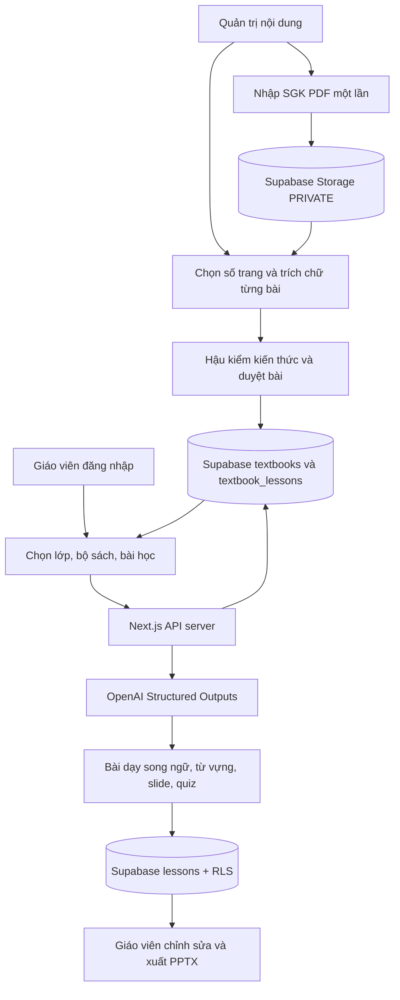

# EDUBRIDGE MVP 1.1 – TÀI LIỆU KIẾN TRÚC

Phiên bản này thay thế luồng giáo viên tự tải PDF/DOCX mỗi lần soạn bài bằng **thư viện SGK tập trung**. Xem tài liệu triển khai chính thức ở `README.md` và chi tiết thiết kế ở `docs/02_KHO_SGK.md`.

**Bảo mật:** Quản trị viên được cấp role `admin` bằng Supabase SQL Editor; người dùng thường không thể tự nâng quyền; PDF SGK gốc không công khai; API soạn bài chỉ chấp nhận ID bài SGK đã duyệt, không nhận văn bản người dùng tự tải lên.

**Giới hạn:** Chưa tự phát hiện mục lục/chia bài từ cả quyển PDF; số trang do quản trị viên xác định, sau đó trích từng bài. Chưa có OCR tự động, LMS hay đánh giá giọng nói.
